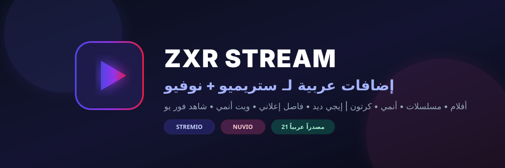
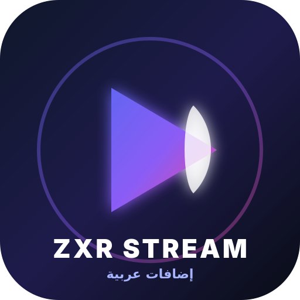
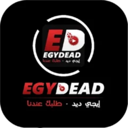

<p align="center">
  
</p>

<h1 align="center">🌟 ZXR Stream — إضافات عربية لـ Stremio و Nuvio 🌟</h1>

<p align="center">
  <b>المستودع العربي الشامل والوحيد الذي يضم جميع المواقع الـ 21 من المستودع الأصلي لتطبيقي Stremio و Nuvio</b>
  <br><br>
  <a href="https://github.com/devilmancrybabyx/ZXR-stream"></a>
  <a href="https://github.com/devilmancrybabyx/ZXR-stream"></a>
  <a href="https://github.com/devilmancrybabyx/ZXR-stream"></a>
  <a href="https://github.com/devilmancrybabyx/ZXR-stream"></a>
</p>

<p align="center">
  🎬 <b>أفلام</b> • 📺 <b>مسلسلات</b> • 🎌 <b>أنمي</b> • 🧸 <b>كرتون وأطفال</b> • 🌏 <b>دراما آسيوية وكورية</b>
  <br>
  يعمل مباشرة من GitHub بدون الحاجة إلى خوادم خارجية أو اشتراكات — جودة عالية وسيرفرات فائقة السرعة بدون إعلانات.
</p>

---

<div align="center">

## ⚡ رابط التثبيت المباشر في تطبيق نوفيو (Nuvio Direct Manifest)

**انسخ الرابط التالي مباشرة من GitHub والصقه داخل تطبيق Nuvio:**

```text
https://raw.githubusercontent.com/devilmancrybabyx/ZXR-stream/main/manifest.json
```

| 📋 رابط Nuvio المباشر (من GitHub فقط) | 📱 لتطبيق Stremio (محلياً أو عبر سيرفرك) |
|:---:|:---:|
| `https://raw.githubusercontent.com/devilmancrybabyx/ZXR-stream/main/manifest.json` | `http://localhost:7000/manifest.json` |
| **جاهز للاستخدام الفوري داخل Nuvio** بدون أي سيرفر خارجي | يتم تشغيله محلياً عبر `npm start` لربطه بستريميو |

</div>

---

## 📸 معرض الصور والمصادر

<p align="center">
  
</p>

| إيجي ديد (EgyDead) | فاصل إعلاني (FaselHD) | شاهد فور يو (Shahid4u) | ويت أنمي (WitAnime) | أنمي فور اب (Anime4Up) |
|:---:|:---:|:---:|:---:|:---:|
|  |  |  |  |  |
| **أفلام ومسلسلات** | **ترجمة حصرية** | **أعمال عربية وتركية** | **أنمي ياباني مترجم** | **أنمي مترجم ومدبلج** |

---

## 📱 الأجهزة والتطبيقات المدعومة

| المنصة | Nuvio (مباشرة عبر GitHub) | Stremio (محلياً / سيرفر) | الحالة |
|:---|:---:|:---:|:---:|
| 📱 **أندرويد (الهواتف والأجهزة اللوحية)** | ✅ مدعوم 100% | ✅ مدعوم | ممتاز ومباشر |
| 📺 **أندرويد TV / Google TV / Firestick** | ✅ مدعوم 100% | ✅ مدعوم | واجهة شاشة كاملة |
| 💻 **ويندوز (Windows 10 / 11)** | ✅ مدعوم 100% | ✅ مدعوم | تم الاختبار بنجاح |
| 🍏 **ماك (macOS) ولينكس (Linux)** | ✅ مدعوم 100% | ✅ مدعوم | تم الاختبار بنجاح |
| 📱 **أجهزة آبل (iOS / iPadOS)** | ✅ مدعوم 100% | ✅ عبر Web | بدون جيلبريك |

---

## 🍿 جميع المصادر العربية الـ 21 بالكامل (من المستودع الأصلي)

تمت إعادة بناء جميع الكواشط الـ 21 الموجودة في المستودع الأصلي لتتوافق مع معايير Nuvio و Stremio:

### 🎬 أولاً: الأفلام والمسلسلات العامة
1. **إيجي ديد (EgyDead)** — أحدث الأفلام والمسلسلات الأجنبية والعربية والمدبلجة.
2. **فاصل إعلاني (FaselHD)** — أشهر موقع عربي للترجمات الاحترافية وسيرفرات البث المتعددة.
3. **شاهد فور يو (Shahid4u)** — مسلسلات عربية وتركية حصرية، وأفلام سينمائية حديثة.
4. **توك توك سينما (TukTuk Cinema)** — عروض المنصات العالمية (Netflix, HBO, Amazon) بجودة فائقة.
5. **سيما ناو (CimaNow)** — مكتبة ضخمة للأعمال العربية والتركية والآسيوية.
6. **توب سينما (TopCinema)** — تصنيفات IMDb للأفلام والمسلسلات الأعلى تقييماً.
7. **سيما كلاود (CimaCloud)** — مكتبة أفلام ومسلسلات عربية وأجنبية.
8. **سيما وبس (Cimawbas)** — مشاهدة وتحميل مباشر للأعمال السينمائية.
9. **إيجي واتش (Egywatch)** — سيرفرات خاصة وأعمال درامية منوعة.
10. **تايم موفيز (TimeMovies)** — سلاسل الأفلام الكاملة وأحدث الإصدارات العالمية.
11. **شوف لايف (ShoofLive)** — مسلسلات حصرية عربية وتركية وسيرفرات AlbaPlayer.

### 🎌 ثانياً: مسلسلات وأفلام الأنمي
12. **ويت أنمي (WitAnime)** — الحلقات الأسبوعية للأنمي الياباني فور صدورها بجودات متعددة.
13. **أنمي فور اب (Anime4Up)** — مكتبة الأنمي الأضخم مع سيرفرات StreamWish و VidHide.
14. **أنمي زد (Animezid)** — مسلسلات وأفلام أنمي مترجمة ومدبلجة.
15. **أنمي عرب (Anime3rb)** — بوابتك لمشاهدة الأنمي المترجم بجودة عالية.
16. **أنمي داي (AnimeDay)** — حلقات متجددة وسيرفرات سريعة.
17. **أنمي ريفت (AnimeRift)** — أحدث مسلسلات الأوفا والأنمي.
18. **أنمي سلاير (AnimeSlayer)** — كاشط متوافق مع سيرفرات تطبيق أنمي سلاير.

### 🧸 ثالثاً: الكرتون، الأطفال، والدراما الآسيوية
19. **ستار ديما (StarDima)** — المركز العربي الأول لكرتون الأطفال والأنمي المدبلج الكلاسيكي والحديث.
20. **مسلسلات كرتون وأنمي (CartoonAnime)** — أفلام ومسلسلات الرسوم المتحركة المدبلجة للعربية.
21. **عالم الدراما (DramaWorld)** — المتخصص في المسلسلات الكورية واليابانية والآسيوية المترجمة والمدبلجة.

---

## ⏱️ طريقة التثبيت في دقيقة واحدة

### 1️⃣ التثبيت في تطبيق Nuvio (بدون أي خادم — عبر GitHub مباشرة):
1. افتح تطبيق **Nuvio**.
2. توجّه إلى **Settings (الإعدادات)** ← قسم **Plugins / Scrapers (الإضافات)**.
3. اضغط على خيار إضافة رابط مخصص **(Add Custom Manifest URL)**.
4. الصق الرابط المباشر من GitHub:
   ```text
   https://raw.githubusercontent.com/devilmancrybabyx/ZXR-stream/main/manifest.json
   ```
5. اضغط **Add / Confirm** وستظهر لك جميع المصادر الـ 21 فوراً داخل التطبيق!

### 2️⃣ التثبيت في تطبيق Stremio:
- **التشغيل المحلي المباشر**:
  ```bash
  # تشغيل الخادم على جهازك
  npm install
  npm start
  ```
  ثم افتح Stremio واذهب إلى قسم **Addons** والصق الرابط:
  `http://localhost:7000/manifest.json` (أو اضغط الرابط `stremio://localhost:7000/manifest.json`).

---

## ⚖️ إخلاء المسؤولية القانونية وحماية حقوق النشر (Legal Disclaimer & DMCA)

> **تنبيه وإخلاء مسؤولية قانوني للمستخدمين وأصحاب الحقوق:**

1. **طبيعة المشروع البرمجية:**
   - إن مشروع **ZXR Stream** هو أداة برمجية ومحرك فهرسة مفتوح المصدر (Scraper / Indexer).
   - **لا يقوم هذا المستودع، ولا مطوره، باستضافة أو رفع أو تخزين أو بث أي ملفات فيديو أو وسائط محمية بحقوق الطبع والنشر إطلاقاً على خوادمه.**
   - جميع الروابط ومصادر الفيديو يتم جلبها وفهرستها بشكل آلي ومباشر من مواقع وسيرفرات خارجية متاحة بالفعل للعموم على شبكة الإنترنت المفتوحة، ولا تخضع لسيطرة أو إدارة صاحب هذا المستودع.

2. **المسؤولية القانونية:**
   - تقع مسؤولية استخدام هذا المشروع بالكامل على عاتق المستخدم النهائي، وعليه مراعاة القوانين المعمول بها في بلده.
   - المطور غير مسؤول عن أي استخدام غير قانوني لمحتوى الأطراف الثالثة.

3. **إشعار أصحاب الحقوق (DMCA Notice):**
   - نحن نحترم حقوق الملكية الفكرية لصناع المحتوى.
   - إذا كنت مالكاً قانونياً لأي محتوى وترغب في إزالة أي رابط مفهرس، يُرجى التواصل معنا بتقديم طلب رسمي عبر قسم Issues في المستودع متضمناً إثبات الملكية، وسيتم حذف الرابط المرجعي فوراً وبشكل حاسم.

---

<p align="center">
  <b>صُنع بشغف لخدمة مجتمع المشاهدة العربي ❤️ — ZXR Stream (devilmancrybabyx)</b>
</p>
